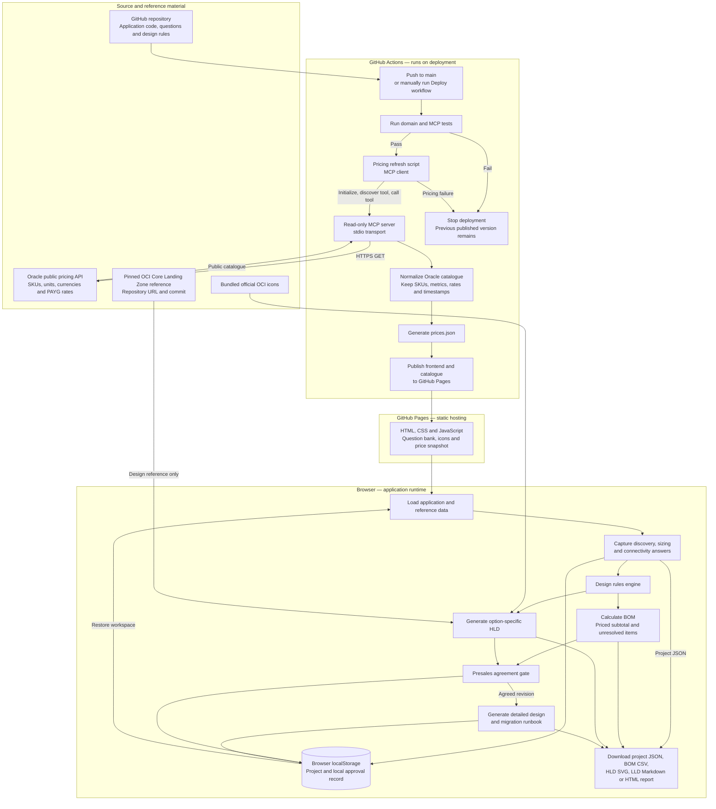
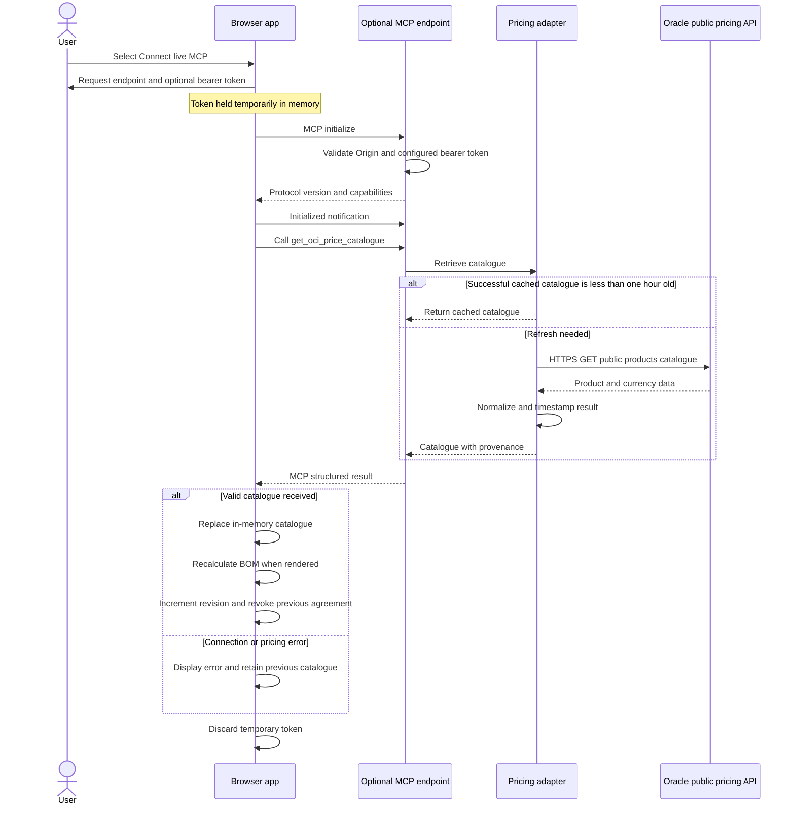

# Backend and end-to-end process flow

These diagrams describe the implemented ADB Design Studio. Execution is split between the browser, GitHub Actions and an optional MCP pricing service. Most design logic runs in the browser. There is no shared application database or authenticated approval backend in the current deployment.

## 1. System architecture and pricing flow

Customer answers stay in the browser. GitHub Actions retrieves the public price catalogue without sending customer discovery data to Oracle. The app does not provision OCI resources. OCI icons are bundled static assets; the landing-zone repository and commit are design references, not a runtime Terraform execution service.

## 2. End-to-end business and design flow

```mermaid
flowchart TB
    START["Create project<br/>or import project JSON"]
    IMPORT{"Imported project?"}
    RESET["Validate file<br/>Clear imported approval"]
    OPTION["Choose one deployment option"]
    PROFILE["Load selected profile<br/>OCI Serverless / OCI Dedicated / Cloud@Customer<br/>AWS Serverless / AWS Dedicated<br/>Azure Serverless / Google Cloud Serverless"]

    START --> IMPORT
    IMPORT -->|Yes| RESET --> OPTION
    IMPORT -->|No| OPTION
    OPTION --> PROFILE

    subgraph PRE["Stage 1 — Presales"]
        INTRO["First conversation: 6 simple topics<br/>Two at a time; choices and optional notes"]
        BRIEF["Create conversation brief<br/>Skip or choose Not sure yet"]
        HANDOFF["Optional architect handoff<br/>One contact and follow-up date<br/>for unanswered and unknown topics"]
        QUESTIONS["Architect follow-up<br/>10 common questions<br/>plus 9 option-specific questions"]
        REGISTER["Record answer, confidence,<br/>owner, due date and evidence"]
        SIZE["Capture measured workload,<br/>pilot calibration, growth and storage"]
        CAPACITY["Calculate proposed compute<br/>and usable storage quantities"]
        NETWORK["Capture client locations, access,<br/>hybrid links, DNS, LZ and recovery needs"]
        PRICES["Load published pricing snapshot"]
        MATCH{"Exact applicable<br/>catalogue SKU available?"}
        COST["Quantity × rate<br/>Using the SKU billing metric"]
        QUOTE["Mark quote-required<br/>Allow evidenced quote or reviewed exclusion"]
        BOM["Build BOM<br/>Show priced subtotal, unpriced scope<br/>and assumptions"]
        HLD["Build HLD<br/>Selected deployment boundaries,<br/>connectivity, governance and recovery intent"]
        REVIEW["Review discovery, sizing,<br/>BOM, HLD and open actions"]

        INTRO --> BRIEF --> HANDOFF --> QUESTIONS
        QUESTIONS --> REGISTER
        REGISTER --> SIZE --> CAPACITY
        REGISTER --> NETWORK
        CAPACITY --> MATCH
        PRICES --> MATCH
        MATCH -->|Yes| COST --> BOM
        MATCH -->|No| QUOTE --> BOM
        NETWORK --> HLD
        BOM --> REVIEW
        HLD --> REVIEW
    end

    PROFILE --> INTRO
    REVIEW --> READY{"Every discovery question answered<br/>or Unknown with owner and due date?<br/>Project, profile and location recorded?"}
    READY -->|No| QUESTIONS
    READY -->|Yes| ACCEPT["Named approver records acceptance<br/>and accepted conditions"]
    ACCEPT --> BASELINE["Save agreed revision,<br/>timestamp, conditions, BOM snapshot<br/>and price provenance"]

    subgraph DETAIL["Stage 2 — Detailed design and migration"]
        FOLLOWUP["Ask implementation questions<br/>for the selected deployment"]
        CONDITIONAL["Reveal additional questions<br/>for online migration, hybrid links,<br/>recovery, fleet or site requirements"]
        CHECK{"Required design answers supplied?"}
        DRAFT["Generate DRAFT LLD<br/>List unanswered design actions"]
        COMPLETE["Generate review-ready LLD<br/>Build sequence, traffic worksheet,<br/>migration, cutover, rollback and acceptance"]
        TECH["External technical review<br/>and implementation approval"]

        FOLLOWUP --> CONDITIONAL --> CHECK
        CHECK -->|No| DRAFT
        DRAFT -->|Provide more information| FOLLOWUP
        CHECK -->|Yes| COMPLETE --> TECH
    end

    BASELINE --> FOLLOWUP
    BASELINE -.-> EDIT["Change presales answers, sizing,<br/>connectivity, costs or pricing baseline"]
    EDIT --> INVALIDATE["Increment revision<br/>Clear agreement and lock Stage 2"]
    INVALIDATE --> REVIEW
```

The first conversation does not require technical reports, per-question action ownership or complete answers. The six topics reuse established requirement IDs. A single-contact handoff assigns outstanding topics for architect follow-up; it does not mark them confirmed or unlock detailed design. Rough answer bands never become technical quantities automatically.

Presales can be conditionally agreed with unresolved costs or technical actions. Agreement unlocks detailed design; it does not make the BOM a complete quotation. Editing detailed-design answers alone preserves the presales agreement. Changing the deployment profile resets option-specific answers, sizing, connectivity, cost lines and detailed-design answers while retaining common discovery answers. Imports always require fresh agreement.

## 3. Optional on-demand MCP pricing connection

The HTTP service code is included in this repository. It is not hosted by GitHub Pages and must be started locally or hosted separately to use this path.

**Refresh published catalogue** reloads the snapshot on GitHub Pages. It does not fetch fresh Oracle prices. Run the Deploy workflow or connect the optional MCP endpoint to retrieve prices from Oracle. A changed published catalogue also invalidates an older agreement when the workspace loads. Live MCP results are held in browser memory; the public catalogue is retrieved again on reload, and a different catalogue timestamp requires renewed agreement.

## Data, security and implementation boundaries

| Component | Runs where | Responsibility |
| --- | --- | --- |
| Discovery UI and project state | Browser | Collect requirements and persist the workspace locally |
| Sizing and BOM engine | Browser | Apply measured sizing rules, exact supported SKU mappings, quote lines and warnings |
| HLD generator | Browser | Render the selected deployment with bundled OCI icons and landing-zone references |
| Agreement gate | Browser | Record a local attestation against a revision; prevent normal UI access to Stage 2 until agreed |
| LLD generator | Browser | Apply option-specific templates and conditional implementation questions |
| Deployment pricing MCP | GitHub Actions process | Fetch the public Oracle catalogue using stdio MCP |
| Optional HTTP MCP | Separately run Node service | Provide on-demand read-only catalogue retrieval with Origin validation and optional bearer authentication |
| GitHub Pages | GitHub | Serve static application files and the published pricing snapshot |
| Technical and commercial approval | Outside the app | Validate design, service eligibility, licensing, quotations and change implementation |

There is no AI model call, shared customer project database, authenticated multi-user approval service, infrastructure provisioning engine or automated migration execution in this implementation. Diagram and runbook generation use programmed rules and templates. Public list pricing does not apply negotiated discounts or control an interactive Oracle Cost Estimator session.

## Source traceability

- [Browser workflow, storage, exports and live MCP client](../web/app.js)
- [Deployment profiles, sizing, BOM, approval rules and LLD generation](../web/engine.js)
- [Short sales conversation, brief and handoff](../web/sales-discovery.js)
- [Sales question bank](../web/data/questions.json)
- [Oracle catalogue retrieval and MCP tool implementation](../server/pricing.mjs)
- [MCP stdio transport](../server/mcp.mjs)
- [Optional MCP HTTP endpoint](../server/http.mjs)
- [Deployment pricing refresh client](../scripts/refresh-prices.mjs)
- [GitHub Pages deployment workflow](../.github/workflows/deploy.yml)
- [Setup, limitations and operating instructions](../README.md)
