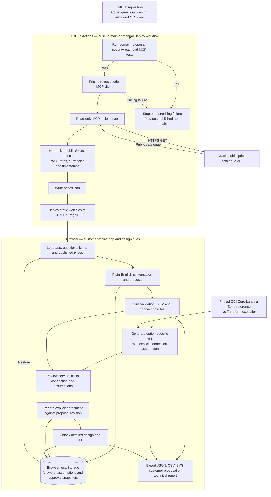
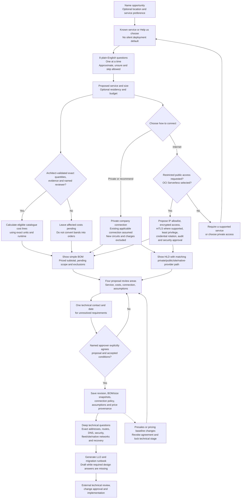
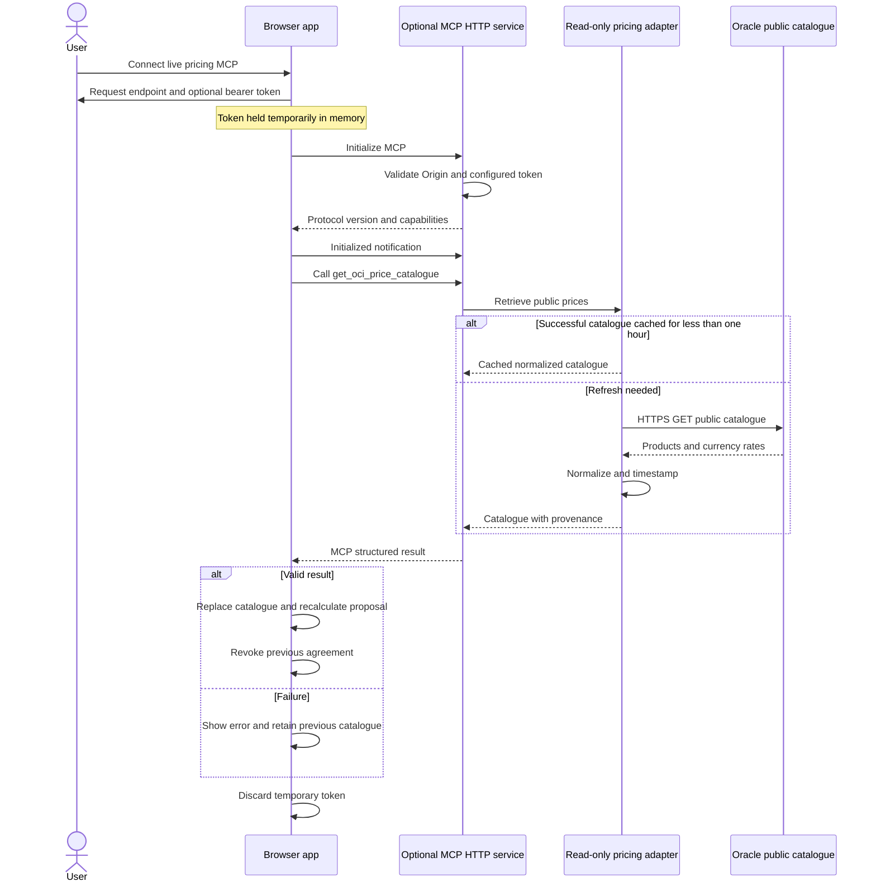

# Backend and end-to-end process flow

The implemented workflow is **simple presales → agreed proposal → deep technical design**. It runs in the browser, GitHub Actions and an optional MCP pricing service. There is no shared customer database or authenticated approval backend in the Pages deployment.

## 1. Application and pricing architecture

Customer answers remain in the browser. The pricing tool fetches only the public Oracle catalogue; it does not send customer answers to Oracle, invoke an AI model, apply negotiated discounts or control a Cost Estimator session. OCI resources and migrations are not executed by this app.

## 2. Sales-to-design workflow and approval gate

A service must be selected before agreement, even though discovery can start without one. Conditional agreement may accept pending quantities, quotes, location or security decisions with a technical contact and date. It does not mark the estimate complete or authorise implementation. The technical question bank is not a prerequisite for sales agreement. Detailed-design answers extend the accepted baseline; changed presales inputs, cost lines or pricing require new agreement.

## 3. Connection assumptions and public-access security

| Selected path | Presales assumption / controls | Detailed-design validation |
| --- | --- | --- |
| OCI private — Serverless or Dedicated | Existing customer-managed VPN or FastConnect reaches the target OCI network. New circuits and carrier/provider charges are excluded. | Reachability, routing and return paths, DNS, capacity, resilience, ownership and the selected service's endpoint/fleet rules |
| Cloud@Customer | Existing customer-site client network is available. New client circuits are excluded. | Facilities, client and backup networks, Oracle control/management connectivity, installation readiness and ownership; these are not assumed to be covered by VPN/FastConnect |
| AWS, Azure or Google Cloud private | Existing applicable customer/provider-native private path is available. New hybrid circuits and provider charges are excluded. | Exact native attachment/delegation, account linkage, provider network ownership, routing, DNS and offer support |
| OCI Serverless restricted public | Approved fixed public IP allowlist; no unrestricted internet access. Encrypted connections and mTLS where supported, limited application identities, protected/rotated credentials, audit/alerts and named security approval before implementation. | Actual egress IPs, DNS, encrypted connection descriptors, client compatibility, account privileges, credential lifecycle, allowlist tests and security sign-off |
| Other deployment with a stale/imported public request | Public access is not offered for this design path in the app. Agreement is blocked. | Select a supported service or resolve the private connection design |

Existing connection exclusions are explicit assumptions, not free new circuits. Network/security configuration, landing-zone work, backups, recovery infrastructure and delivery retain their own cost scope. HLD, BOM, proposal report, approval snapshots and LLD carry the connection assumption consistently.

## 4. Optional on-demand pricing MCP

The HTTP service is included as code but is not hosted by GitHub Pages.

**Refresh published prices** only reloads the Pages snapshot. Run the Deploy workflow or connect the separately running MCP service for a fresh Oracle fetch. A changed published catalogue invalidates an older approval on workspace load. No recurring schedule or paid runtime is created.

## Storage, compatibility and export boundaries

- Answers and approval data are saved in browser localStorage; no shared customer project database is deployed.
- Old answers/evidence survive upgrade, but older approval records require renewed agreement under the new assumption model. Imported files always reset agreement.
- Existing measured sizing logic is retained for legacy data and tests; the new proposal uses explicit architect-validated target quantities.
- Presales exports contain the simple conversation, service/size proposal, costs, HLD, assumptions and agreement wording. Post-agreement reports additionally contain the LLD and technical requirements register.
- Approval is a local attestation, not authenticated multi-user acceptance. No provisioning, migration execution or final commercial purchase occurs in this app.

## Source traceability

- [Browser routing, state, approval and exports](../web/app.js)
- [Presales conversation, validation and connection policy](../web/presales-model.js)
- [Plain-English presales screens](../web/presales-ui.js)
- [Sizing, BOM, approval and detailed-design engine](../web/engine.js)
- [Private/public/site/native-provider HLD generator](../web/hld.js)
- [Customer proposal and technical report generator](../web/reports.js)
- [Technical question bank](../web/data/questions.json)
- [Pricing MCP tool](../server/pricing.mjs), [stdio transport](../server/mcp.mjs), [optional HTTP service](../server/http.mjs)
- [Deployment pricing client](../scripts/refresh-prices.mjs) and [Pages workflow](../.github/workflows/deploy.yml)
- [Setup and operating instructions](../README.md)
